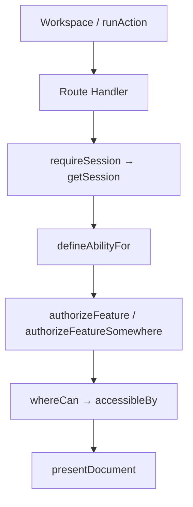

# アーキテクチャ

どの関数がどの順で認可するかは [関数の呼び出し](./calls.md) に図があります。

## 画面と API

画面は `Workspace` です。左が `SampleScreens`（ボタンから API を呼ぶ）、右が `Comparison`（保存データと、各人物に返る値）です。どちらも `/api` を `fetch` します。`page.tsx` は `Workspace` を置くだけです。

| 呼び出し | 役割 |
| --- | --- |
| `GET /api/personas` | 切り替え用の人物と、所属ごとの機能状態。認可しない |
| `POST /api/session` | 選んだユーザー ID を `scylla_user` クッキーに入れる |
| `GET /api/me` | クッキーのユーザーを `toPersonaProfile` で返す |
| `GET /api/catalog` | 比較表。全件と、各人物の `data` Ability で見える行 |
| `GET /api/projects` | 読めるプロジェクトと、変換済みの文書 |
| `POST /api/projects` | プロジェクト作成 |
| `POST /api/projects/[id]/archive` | アーカイブ |
| `POST /api/documents` | 下書き作成 |
| `POST /api/documents/[id]/publish` | 公開 |
| `GET /api/audit` | 監査。契約と API 操作を通過した組織の文書 |

クッキーはデモ用の平文ユーザー ID です。署名もパスワードもありません。本番のログインを足すときは、このクッキーを検証済みのユーザー ID に置き換えます。`defineAbilityFor` の入力は `Principal`（ユーザー ID と所属のロール、部門、クリアランス）です。プランは Principal に入れず、組織の属性としてゲートが別に見ます。

## 2 つの Ability

`defineAbilityFor` は `Access` を返します。

- `data` は Prisma の `WhereInput` を条件にする Ability です。行の読み書きと、項目の `view` / `mask` / `replace` を持ちます。
- `api` は Mongo クエリを条件にする Ability です。サブジェクトは `Api` で、`resource`、`operation`、`organizationId` を見ます。どの API 操作を、どの組織で起動できるかだけを決め、行の中身は見ません。

契約の有無は Ability の外です。`src/lib/authz/contract.ts` がプランごとの機能一覧を持ち、`src/lib/authz/gate.ts` が契約を先に見てから `api.can` を呼びます。`api` のルールは `api-access.ts`、行は `rows.ts`、項目は `fields.ts` です。

## 機能の 3 状態

`featureState` は契約と API Ability から画面用の状態を作ります。`toPersonaProfile` が所属ごとに計算し、`screenFeatureState` がボタン 1 つにまとめます。

| 状態 | 条件 | 画面 | API |
| --- | --- | --- | --- |
| `hidden` | プランに機能が無い | 出さない | 404、`layer: "contract"` |
| `disabled` | プランにあり、API Ability が拒否 | 無効なボタンとして残す | 403、`layer: "resource"` |
| `enabled` | 両方を満たす | 操作できる。行の条件でさらに無効になることがある | 行と項目の判定へ進む |

行ごとのアーカイブと公開は、機能が `enabled` でも `data` Ability がその行を拒否すれば `disabled` に落とします。契約に無い組織では、行があってもボタン自体を出しません。

Acme は Enterprise なので作成も監査も契約に含まれます。Evan はゲストなので作成は無効、Ben は管理者なので監査は有効です。Nimbus は Starter なので、Faye がオーナーでも作成と監査は非表示です。

## リクエストの中の段

セッションが無ければ 401、`layer: "session"` です。入力が不正なら 400、`layer: "input"` です。

その後の拒否は層の名前をレスポンスに載せます。

| 層 | 見ているもの | 成功したあと |
| --- | --- | --- |
| `contract` | 対象組織のプランが機能を含むか。一覧系は所属組織のどれか | API Ability |
| `resource` | その組織で `api.can("access", Api)` か | 行の条件 |
| `attribute` | 候補オブジェクトの `data.can`、または `updateMany` が 1 件か | 作成、更新、または項目の変換 |
| 項目 | `presentDocument` | 本文と著者メールを変換した JSON |

一覧の `GET /api/projects` と `GET /api/audit` は、`authorizeFeatureSomewhere` で契約と API 操作を通過した組織 ID だけを `where` に足します。文書作成は、先に読めるプロジェクトを引き、その組織で `documents.create` をゲートしてから候補を `data.can("create")` します。プロジェクトが見えなければ、契約の 404 より先に `attribute` の 403 になります。アーカイブと公開は、先に機能ゲートを通し、その組織 ID と `whereCan` を両方 `updateMany` に入れ、件数が 1 のときだけ成功にします。

## ファイルの役割

| ファイル | 役割 |
| --- | --- |
| `prisma/schema.prisma` | 組織の `plan`、所属、プロジェクト、文書 |
| `prisma/seed.ts` | Acme は Enterprise、Nimbus は Starter。認可を通さない別クライアントで投入する |
| `src/lib/authz/contract.ts` | プランごとの機能と、`hidden` / `disabled` / `enabled` |
| `src/lib/authz/api-access.ts` | その組織でその API を呼んでよいか |
| `src/lib/authz/rows.ts` | どの行を WHERE で残すか。`whereCan` |
| `src/lib/authz/fields.ts` | 本文と著者メールの表示、マスク、置換 |
| `src/lib/authz/ability.ts` | 上のルールから `data` と `api` を組み立てる |
| `src/lib/authz/gate.ts` | 契約を先に見てから API Ability を呼ぶ |
| `src/lib/authz/action-state.ts` | 行ごとのボタンを hidden / disabled / enabled にする |
| `src/lib/authz/casl.ts` | Prisma 7 向けの `data` Ability 型 |
| `src/lib/session.ts` | クッキーから Principal、組織のプラン、`Access` を組み立てる |
| `src/lib/authz/profile.ts` | 画面向けの人物。`featureMap` と `explainDataAccess` |
| `src/lib/dal.ts` | 一覧、監査、比較表、人物一覧 |
| `src/lib/api.ts` | セッション必須、層付きの JSON、preview 判定 |
| `src/app/api/**` | Route Handler |
| `src/app/workspace.tsx` | 左のサンプル画面と右の対応表 |
| `src/sample/**` | ボタンと、ボタンから API を呼ぶ処理 |
| `src/guide/comparison.tsx` | 対応表の表示 |

`next.config.ts` は `@prisma/client`、`@prisma/adapter-pg`、`pg` を `serverExternalPackages` にしています。

## CASL と Prisma

Prisma 7 のクライアントは `src/generated/prisma` に出ます。`src/lib/authz/casl.ts` が `@casl/prisma/runtime` の `createPrismaAbility` と `PrismaQueryOf` をその型で包みます。行の条件は Prisma の `WhereInput` です。関係を条件にするときは `project: { is: ... }` のように演算子を付けます。

Prisma のオブジェクトはクラスではないので、インスタンス検査では `subject("Project", record)` または `subject("Document", record)` を使います。サブジェクト名はサーバーが決めます。API Ability のサブジェクト名は `"Api"` です。

一致する `data` ルールが無いとき、`accessibleBy(...).ofType(...)` は空条件を返します。共有の Prisma クライアントには `createCaslExtension()` が付いており、空条件は 0 件になります。所属が無い Principal のプロジェクト一覧は空配列です。

`defineAbilityFor` は `cannot` を使いません。CASL の反転ルールはそのアクション全体に掛かるため、Aoi のように Acme のオーナーかつ Nimbus のゲストである所属を OR で足す形と干渉します。制限は許可条件の中に書きます。

## デモの境界

- `GET /api/personas`、`POST /api/session`、`GET /api/catalog` は認可しません。学習用に誰へでも切り替えられ、比較表は全件を読みます。
- クッキーを書き換えれば別ユーザーになれます。
- サンプルの作成、アーカイブ、公開は `x-scylla-sample: preview` を付け、認可が成功したあとで行を戻します。
- オーナーの `manage Membership` に対応する API はありません。ルールとインスタンス検査のテストだけがそれを固定しています。
- seed 用クライアントには CASL 拡張を付けていません。
