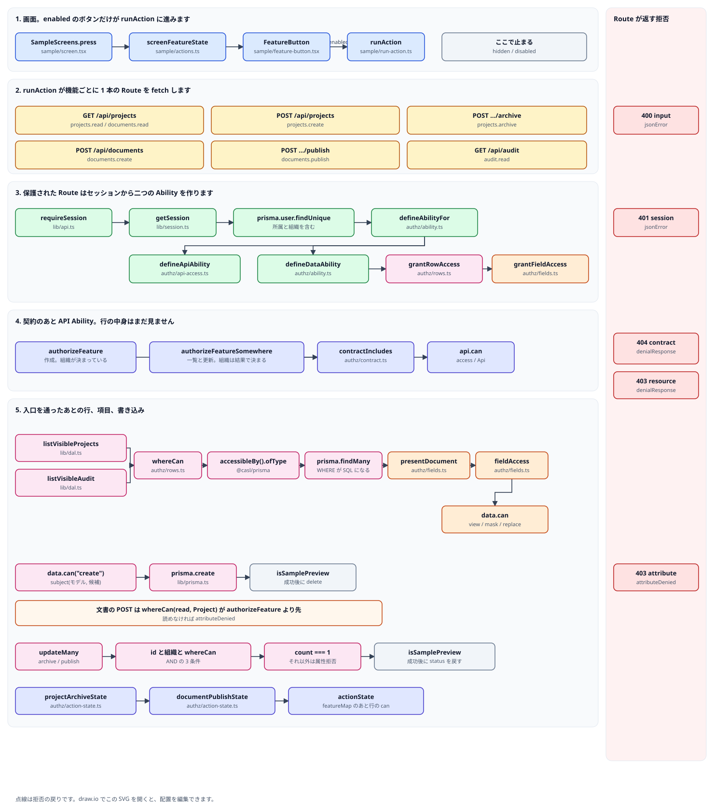
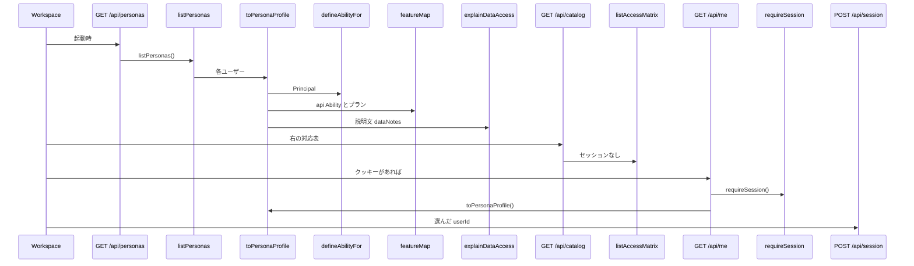
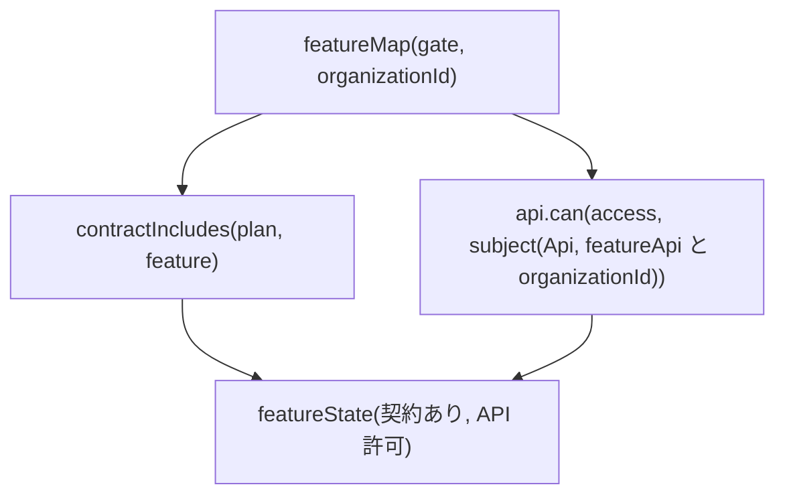
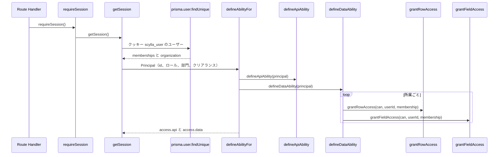
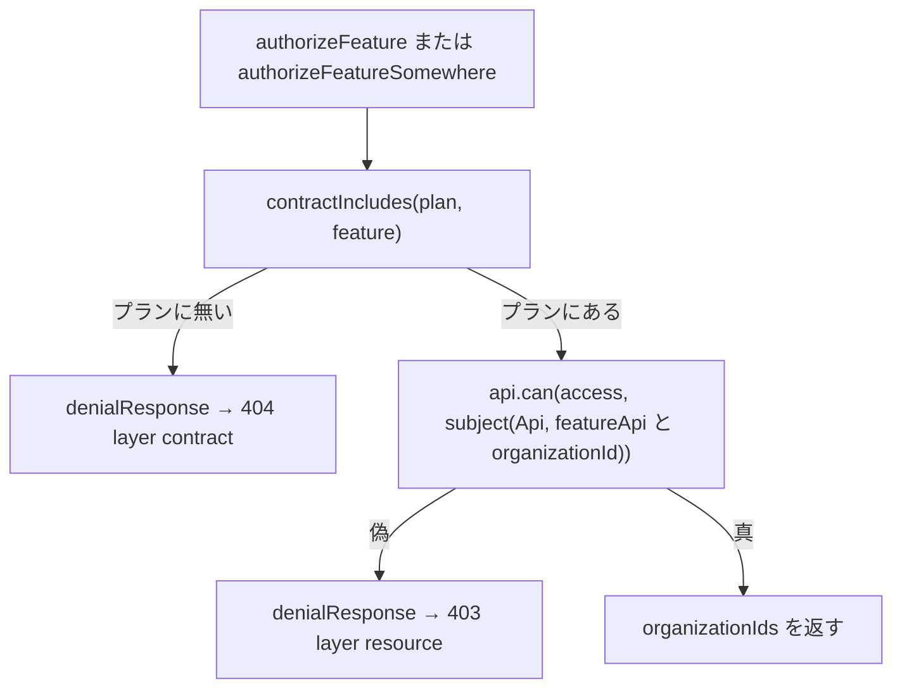
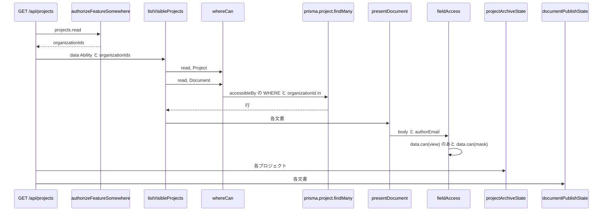
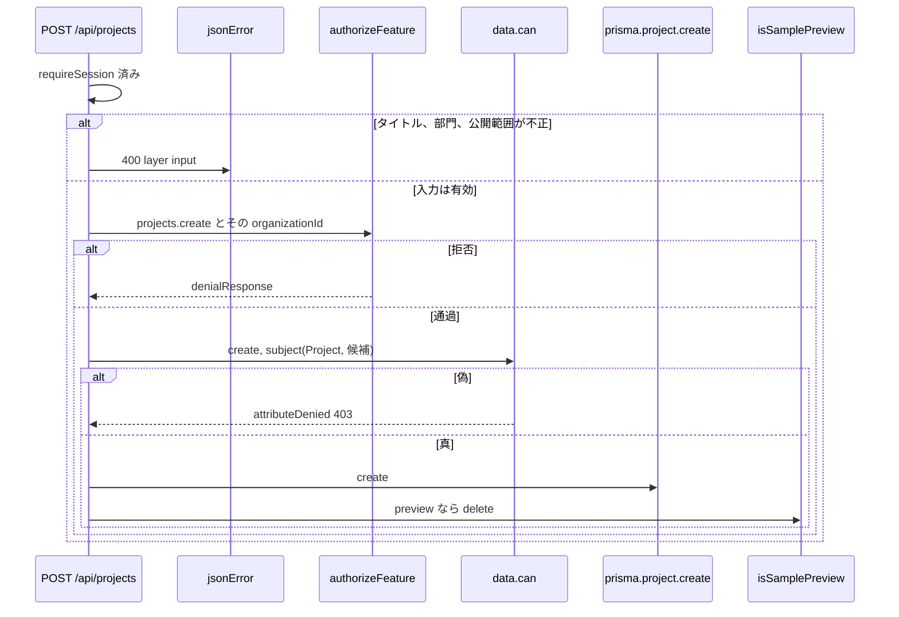
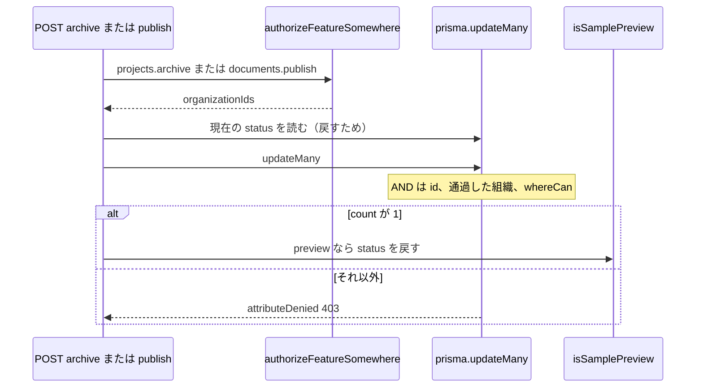
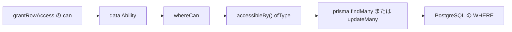
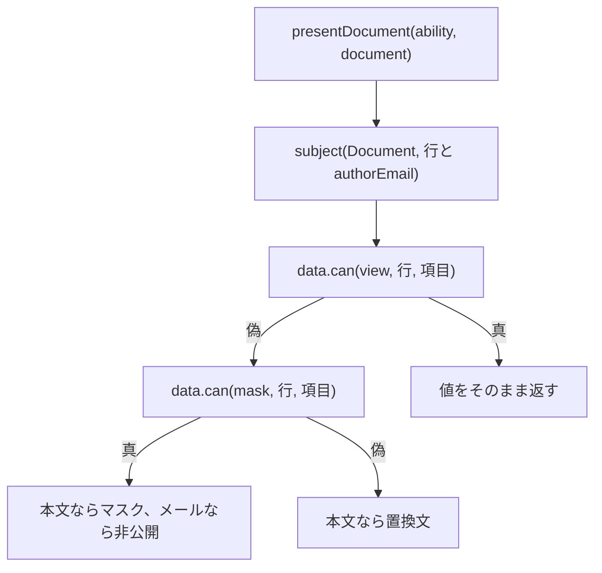

# 関数の呼び出し

ボタンを押してから JSON が返るまで、どの関数がどの関数を呼ぶかを追います。誰に何を許すかの中身は [認可ルール](./authorization.md)、テーブルは [データベース](./database.md) です。

コードを開く順番は `src/lib/authz/ability.ts` のコメントと同じです。

1. `principal.ts` が、誰かを表します。ロール、部門、クリアランスです。
2. `contract.ts` が、プランにその機能があるかを見ます。無ければ画面は非表示、API は 404 です。
3. `api-access.ts` が、その組織でその API を呼んでよいかを見ます。だめなら画面は無効、API は 403 です。
4. `rows.ts` が、どの行を WHERE で残すかを決めます。
5. `fields.ts` が、残った行の本文とメールを、表示、マスク、置換のどれにするかを決めます。
6. `gate.ts` が、Route から 2 のあと 3 を実行する入口です。

全体を一枚にした図です。経路ごとの順番は、このあとのシーケンス図でほどいています。図が小さく見えるときは [call-map.svg](./diagrams/call-map.svg) を開き、draw.io でも編集できます。



## 関数の置き場所

| 関数 | ファイル | 役割 |
| --- | --- | --- |
| `screenFeatureState` | `src/sample/actions.ts` | 所属ごとの状態を、ボタン 1 つの状態にまとめる |
| `FeatureButton` | `src/sample/feature-button.tsx` | 非表示、無効、有効を描く |
| `runAction` | `src/sample/run-action.ts` | 有効なボタンから API を `fetch` する |
| `requireSession` | `src/lib/api.ts` | セッションが無ければ 401 |
| `getSession` | `src/lib/session.ts` | クッキーからユーザーを読み、Ability を作る |
| `defineAbilityFor` | `src/lib/authz/ability.ts` | `data` と `api` の二つの Ability を返す |
| `defineApiAbility` | `src/lib/authz/api-access.ts` | API 入口の `can` を所属ごとに足す |
| `grantRowAccess` | `src/lib/authz/rows.ts` | 行の `can` を所属ごとに足す |
| `grantFieldAccess` | `src/lib/authz/fields.ts` | 項目の `view` / `mask` / `replace` を足す |
| `authorizeFeature` | `src/lib/authz/gate.ts` | 組織が決まっている操作の入口 |
| `authorizeFeatureSomewhere` | `src/lib/authz/gate.ts` | 所属のどれかで許されればよい操作の入口 |
| `contractIncludes` | `src/lib/authz/contract.ts` | プランがその機能を含むか |
| `featureState` | `src/lib/authz/contract.ts` | 契約と API 許可から `hidden` / `disabled` / `enabled` |
| `whereCan` | `src/lib/authz/rows.ts` | 行ルールを Prisma の `where` にする |
| `presentDocument` | `src/lib/authz/fields.ts` | 本文と著者メールを変換する |
| `actionState` | `src/lib/authz/action-state.ts` | 契約、API、その行、の順でボタン状態を決める |
| `listVisibleProjects` / `listVisibleAudit` | `src/lib/dal.ts` | WHERE で行を引き、文書を `presentDocument` に渡す |
| `toPersonaProfile` | `src/lib/authz/profile.ts` | 画面用に、所属ごとの機能状態を付ける |
| `denialResponse` / `attributeDenied` / `jsonError` | `src/lib/api.ts` | 層の名前付き JSON |

`defineAbilityFor` はルールを書きません。`defineApiAbility`、`grantRowAccess`、`grantFieldAccess` を呼んで組み立てます。

## ページを開いたとき

`Workspace` は、操作の API を呼ぶ前に次の 4 本を呼びます。人物一覧、比較表、今のクッキー、セッションの保存です。



`toPersonaProfile` の中では、所属ごとに `featureMap` が動きます。



`featureState` は、契約が無ければ `hidden`、契約があって API が拒否なら `disabled`、両方とも通れば `enabled` を返します。

`GET /api/personas`、`POST /api/session`、`GET /api/catalog` は、この学習用の切り替えと比較表のための API です。契約ゲートは通しません。`POST /api/session` は、その ID のユーザーがいるときだけ `scylla_user` クッキーを書きます。ボタンを押したあとの判定は、このクッキーを `getSession` が読み直します。

右の `Comparison` は `GET /api/catalog` の結果を表にします。`listAccessMatrix` は保存されているプロジェクトをすべて読み、ユーザーごとに `defineAbilityFor` した `data` Ability で `listVisibleProjects` を呼びます。押したボタンの認可は、この API では行いません。

## ボタンの色

右ペインのボタンは `sampleActions` の 7 つです。各ボタンの状態は `screenFeatureState` です。所属のどれか一つでも `enabled` ならボタンは `enabled`、無ければ `disabled` が一つでもあれば `disabled`、全部 `hidden` なら `hidden` です。

`FeatureButton` は `hidden` のとき破線の「非表示」を描き、`disabled` のときボタンを押せなくします。`enabled` のときだけ `SampleScreens.press` が `runAction` を呼びます。左の見本ペインは状態を `enabled` に固定し、API は呼びません。

ボタンの色は、ページを開いたときに `toPersonaProfile` が計算した `features` です。押したあとの API は、クッキーのユーザーで Ability を作り直して判定します。

## runAction が選ぶ URL

| ボタン | `runAction` が呼ぶもの |
| --- | --- |
| プロジェクトを取得、文書を取得 | `GET /api/projects` |
| プロジェクトを作成 | `POST /api/projects`。ヘッダ `x-scylla-sample: preview` |
| プロジェクトをアーカイブ | 一覧で `archive === "enabled"` の行へ `POST /api/projects/:id/archive` |
| 文書を作成 | 作成できる組織の、アーカイブされていないプロジェクトへ `POST /api/documents` |
| 文書を公開 | 一覧で `publish === "enabled"` の文書へ `POST /api/documents/:id/publish` |
| 監査を取得 | `GET /api/audit` |

文書の取得もプロジェクトの取得も、同じ `GET /api/projects` です。文書の取得は、返った文書の ID を右の表で強調します。アーカイブと公開は、先に一覧を持っていて、その行の `archive` または `publish` が `enabled` のときだけ POST します。該当行が無ければ HTTP は呼びません。

## 保護された Route の入口

`GET /api/projects`、`POST /api/projects`、アーカイブ、文書の作成、公開、`GET /api/audit` は、最初に同じ関数を呼びます。



クッキーが無い、またはユーザーが無いとき、`requireSession` は `jsonError(401, "session", ...)` を返し、Route はそこで終わります。

プランは `Principal` に入りません。`getSession` が `session.user.organizations` に残し、次のゲートが見ます。`grantRowAccess` と `grantFieldAccess` は、この時点ではルールを Ability に登録するだけで、データベースはまだ読みません。

## 契約と API 入口

Route は `gate` を `{ api: session.access.api, organizations: session.user.organizations }` で作ります。

組織がリクエストで決まっている作成は `authorizeFeature(gate, organizationId, feature)` です。一覧と、URL の ID だけでは組織が決まらないアーカイブと公開は `authorizeFeatureSomewhere(gate, feature)` です。中で呼ぶ関数は同じです。



`featureApi` は `"projects.create"` のような機能名を、`resource` と `operation` に分けます。`defineApiAbility` が登録した条件と、ここで作る `subject("Api", ...)` が揃ったとき、`api.can` が真になります。

`authorizeFeatureSomewhere` は、契約がある所属だけを残し、その中で `api.can` が真の組織 ID だけを返します。一つも残らなければ 403 です。契約のある所属がゼロなら 404 です。

## プロジェクトと文書の取得

`GET /api/projects` は、入口のあと行を引き、各行のボタン状態を足して返します。



`listVisibleProjects` の `where` は、`whereCan(ability, "read", "Project")` と、ゲートが返した `organizationId` の両方です。文書の `where` は `whereCan(ability, "read", "Document")` です。返した文書は `presentDocument` を通ります。

`projectArchiveState` と `documentPublishState` は `actionState` を呼びます。`actionState` は `featureMap` の状態が `enabled` のときだけ、`data.can("archive", subject("Project", 行))` または `data.can("publish", subject("Document", 行))` を見ます。機能が `enabled` で行が拒否なら、その行のボタンは `disabled` です。

`GET /api/audit` も同じ入口です。`authorizeFeatureSomewhere(gate, "audit.read")` のあと `listVisibleAudit` が `whereCan(ability, "read", "Document")` と、通過した組織の条件を AND し、各文書を `presentDocument` に渡します。行ごとのアーカイブや公開の状態は付けません。

## プロジェクトの作成



候補はまだデータベースに無いので、`whereCan` は使いません。`subject("Project", 候補)` に、ルールが読むフィールド（組織、所有者、部門、公開範囲、状態）を載せて `data.can` します。所有者はセッションのユーザー ID です。クライアントの値は使いません。

## 文書の作成

文書の作成は、親プロジェクトを先に読みます。

```mermaid
sequenceDiagram
  participant Route as POST /api/documents
  participant WC as whereCan
  participant DB as prisma.project.findFirst
  participant Gate as authorizeFeature
  participant Data as data.can
  participant Create as prisma.document.create

  Route->>Route: requireSession と入力検査
  Route->>WC: read, Project
  Route->>DB: id と whereCan の AND
  alt 行が無い
    DB-->>Route: attributeDenied 403
  else 読めた
    Route->>Gate: その組織の documents.create
    Route->>Data: create, subject(Document, 候補と親 project)
    Route->>Create: 通過したときだけ create
    Route->>Route: preview なら delete
  end
```

親が読めないときは、契約の 404 より先に `attributeDenied` です。読めたあとで `authorizeFeature`、そのあと `data.can("create", subject("Document", 候補))` です。候補には親 `project` を含めます。ルールが `project: { is: ... }` を見るためです。

## アーカイブと公開

アーカイブと公開は、入口のあと `updateMany` の WHERE で行を判定します。先に 1 件読んでから更新する、という手順にはしません。



アーカイブの `whereCan` は `archive` / `Project` です。公開は `publish` / `Document` で、組織の条件は `project.organizationId` です。`count === 1` のときだけ成功です。サンプル画面の preview は、成功したあとで元の `status` に戻します。判定はその前に終わっています。

## whereCan から SQL まで

`whereCan(ability, action, モデル)` は `accessibleBy(ability, action).ofType(モデル)` を返します。`accessibleBy` はデータベースを読みません。`grantRowAccess` が `can` に登録した条件を、Prisma の `WhereInput` にまとめます。



一致する行ルールが無いとき、`accessibleBy` は空の OR を返します。共有の `prisma` には `createCaslExtension()` が付いており、そのクエリは 0 件になります。Prisma Client が `WhereInput` を SQL にコンパイルし、`@prisma/adapter-pg` が PostgreSQL に送ります。

項目の `view` / `mask` / `replace` は `whereCan("read", ...)` には入りません。`grantFieldAccess` が別アクションにしているので、一覧の WHERE は行を残す条件だけです。

## 項目の変換

`presentDocument` は、読めた 1 行を API の形にします。



`fieldAccess` は `body` と `authorEmail` でこれを 1 回ずつ呼びます。タイトル、状態、等級は `grantFieldAccess` が読める行に `view` を付けているので、行が返っていればそのままです。

## 書き込みを戻すところ

サンプルの作成、アーカイブ、公開は `x-scylla-sample: preview` を付けます。Route の `isSamplePreview` は、認可が成功して書き込んだあとで動きます。作成は `delete`、アーカイブと公開は元の `status` への `update` です。右の対応表の行数は変わりません。
