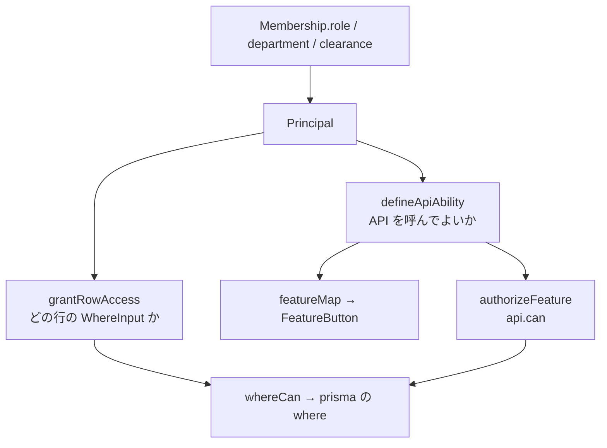

# 画面の出し分けと API の認可

この文書で追うのは二つです。

1. 画面のボタンを、非表示、無効、有効のどれで描くか。
2. API が、ロールから Prisma の `where` を作り、行を残すか。

どちらも同じ所属データを使います。ロールはユーザーではなく、組織への所属（`Membership`）にあります。



ボタンの色は上側の `api` から決まります。データベースの WHERE は下側の `row` から決まります。契約（プラン）は Ability の外で、ボタンでは「非表示」、API では 404 になります。

## ロールはどこで定義されているか

データベースの列挙型が正です。

```10:15:prisma/schema.prisma
enum MembershipRole {
  owner
  admin
  member
  guest
}
```

その値は `Membership` の列です。同じ人でも組織が違えばロールが違います。Aoi は Acme では `owner`、Nimbus では `guest` です。

```59:70:prisma/schema.prisma
model Membership {
  id             String         @id @default(cuid())
  userId         String
  organizationId String
  role           MembershipRole
  department     String
  clearance      Int
  user           User           @relation(fields: [userId], references: [id], onDelete: Cascade)
  organization   Organization   @relation(fields: [organizationId], references: [id], onDelete: Cascade)

  @@unique([userId, organizationId])
}
```

TypeScript 側の同じ4つは `principal.ts` にあります。認可の関数が受け取るのは `Principal` です。中にあるのはユーザー ID と、所属ごとのロール、部門、クリアランスです。メールもプランも入れません。プランは組織の `plan` として、あとでゲートが見ます。

```1:2:src/lib/authz/principal.ts
export const membershipRoles = ["owner", "admin", "member", "guest"] as const;

export type MembershipRole = (typeof membershipRoles)[number];
```

認可の関数が受け取る形は、そのあとの `Principal` です。

```21:36:src/lib/authz/principal.ts
export type MembershipAttributes = {
  organizationId: string;
  role: MembershipRole;
  department: string;
  clearance: number;
};

export type Principal = {
  id: string;
  memberships: MembershipAttributes[];
};
```

リクエストのたびに `getSession` がクッキーのユーザーを読み、所属の列を `Principal` にコピーして `defineAbilityFor` に渡します。Ability は保存しません。

```46:54:src/lib/session.ts
  const principal: Principal = {
    id: user.id,
    memberships: user.memberships.map((membership) => ({
      organizationId: membership.organizationId,
      role: membership.role,
      department: membership.department,
      clearance: membership.clearance,
    })),
  };
```

`defineAbilityFor` は所属の数だけルールを足します。API 用と行用の二つを返します。

```31:44:src/lib/authz/ability.ts
export function defineAbilityFor(principal: Principal): Access {
  return {
    data: defineDataAbility(principal),
    api: defineApiAbility(principal),
  };
}

function defineDataAbility(principal: Principal): AppAbility {
  const { can, build } = new AbilityBuilder<AppAbility>(createPrismaAbility);

  for (const membership of principal.memberships) {
    grantRowAccess(can, principal.id, membership);
    grantFieldAccess(can, principal.id, membership);
  }
```

## ロールは二種類のルールになる

### API を呼んでよいか

`defineApiAbility` はロールを見て `can("access", "Api", 条件)` を足します。この条件は SQL の WHERE ではありません。あとで `api.can` が、渡されたオブジェクトと比べます。

```23:43:src/lib/authz/api-access.ts
  for (const membership of principal.memberships) {
    const organizationId = membership.organizationId;

    can("access", "Api", { resource: "projects", operation: "read", organizationId });
    can("access", "Api", { resource: "documents", operation: "read", organizationId });

    if (membership.role === "guest") continue;

    can("access", "Api", { resource: "projects", operation: "create", organizationId });
    can("access", "Api", { resource: "projects", operation: "archive", organizationId });
    can("access", "Api", { resource: "documents", operation: "create", organizationId });
    can("access", "Api", { resource: "documents", operation: "publish", organizationId });

    if (membership.role === "owner" || membership.role === "admin") {
      can("access", "Api", { resource: "audit", operation: "read", organizationId });
    }
  }
```

ゲストは `continue` するので、参照の2行だけが残ります。メンバーは作成と公開まで足し、監査は足しません。ルールが無い操作は `api.can` が偽になります。`cannot` は使いません。Aoi のように別組織で許可されている操作まで消えるためです。

### どの行を残すか

`grantRowAccess` は、ロールから Prisma の `WhereInput` を作り、それを `can` の条件にします。ここが WHERE の元です。

メンバーがプロジェクトを読む条件は `readableProjectWhere` のこの形です。

```62:84:src/lib/authz/rows.ts
export function readableProjectWhere(userId: string, membership: MembershipAttributes): Prisma.ProjectWhereInput {
  if (membership.role === "owner" || membership.role === "admin") {
    return { organizationId: membership.organizationId };
  }

  const visibleToMember: Prisma.ProjectWhereInput = {
    OR: [
      { visibility: "organization" },
      { visibility: "department", department: membership.department },
      { ownerId: userId },
    ],
  };

  if (membership.role === "guest") {
    return {
      organizationId: membership.organizationId,
      AND: [visibleToMember, { OR: [{ status: { not: "draft" } }, { ownerId: userId }] }],
    };
  }

  return { organizationId: membership.organizationId, ...visibleToMember };
}
```

Chloe（Acme の member、部門 engineering）なら、関数が返すオブジェクトは次です。

```ts
{
  organizationId: "acme の id",
  OR: [
    { visibility: "organization" },
    { visibility: "department", department: "engineering" },
    { ownerId: "chloe の id" },
  ],
}
```

Ben（admin）なら `{ organizationId: "acme の id" }` だけです。Evan（guest）はメンバーの条件に加え、他人の `draft` を外します。

このオブジェクトを、読み取りルールとして登録します。

```20:23:src/lib/authz/rows.ts
  can("read", "Organization", { id: organizationId });
  can("read", "Membership", { organizationId });
  can("read", "Project", readableProject);
  can("read", "Document", readableDocument);
```

文書の条件は `readableDocumentWhere` です。親プロジェクトが上の条件で読めることを `project: { is: ... }` で表し、メンバーとゲストはさらに「公開済み、または自分が著者」を AND します。等級はこの WHERE には入りません。

所属が二つある Aoi は、Acme 用の `can("read", "Project", ...)` と Nimbus 用の `can` が両方登録されます。CASL は同じアクションの条件を OR でまとめます。

## API がその WHERE を使うまで

`GET /api/projects` は二段です。先に API を呼んでよいかを見て、通った組織だけで行を引きます。

```9:19:src/app/api/projects/route.ts
export async function GET() {
  const result = await requireSession();
  if ("response" in result) return result.response;
  const { session } = result;
  const gate = { api: session.access.api, organizations: session.user.organizations };
  const allowed = authorizeFeatureSomewhere(gate, "projects.read");
  if (!allowed.ok) return denialResponse(allowed);

  const projects = await listVisibleProjects(session.access.data, allowed.organizationIds);
```

`authorizeFeatureSomewhere` は WHERE を作りません。プランが機能を含むかを `contractIncludes` で見て、そのあと `api.can` でロールのルールと照合します。

```84:109:src/lib/authz/gate.ts
export function authorizeFeatureSomewhere(gate: FeatureGate, feature: Feature): GateAllow | GateDenial {
  const contracted = gate.organizations.filter((organization) => contractIncludes(organization.plan, feature));
  if (contracted.length === 0) {
    return {
      ok: false,
      status: 404,
      layer: "contract",
      error: "この契約ではその機能を利用できません",
    };
  }

  const organizationIds = contracted
    .filter((organization) =>
      gate.api.can("access", subject("Api", { ...featureApi[feature], organizationId: organization.id })),
    )
    .map((organization) => organization.id);

  if (organizationIds.length === 0) {
    return {
      ok: false,
      status: 403,
      layer: "resource",
      error: "この API を呼び出す権限がありません",
    };
  }

  return { ok: true, organizationIds };
}
```

`projects.read` の `featureApi` は `{ resource: "projects", operation: "read" }` です。`subject("Api", { resource: "projects", operation: "read", organizationId })` が、上で `can` した条件と揃えば真です。契約のある所属がゼロなら 404、ロールのルールが一つも当たらなければ 403 です。返るのは通った組織 ID の配列です。

行の WHERE は `listVisibleProjects` が組み立てます。

```116:130:src/lib/dal.ts
  const projects = await prisma.project.findMany({
    where: {
      AND: [
        whereCan(ability, "read", "Project"),
        ...(organizationIds ? [{ organizationId: { in: organizationIds } }] : []),
      ],
    },
    // ...
      documents: {
        where: whereCan(ability, "read", "Document"),
```

`whereCan` は登録済みの `can` 条件を Prisma の `where` に戻す関数です。データベースは読みません。

```122:124:src/lib/authz/rows.ts
export function whereCan<T extends SubjectName>(ability: AppAbility, action: AppActions, subjectType: T) {
  return accessibleBy(ability, action).ofType(subjectType);
}
```

`accessibleBy(ability, "read").ofType("Project")` は、`can("read", "Project", 条件)` の条件を集めます。所属が一つなら、その条件がそのまま `where` になります。所属が複数なら OR になります。項目の `view` / `mask` / `replace` は別アクションなので、この WHERE には入りません。

Chloe の一覧は、概念的には次の条件です。Prisma がこれをパラメータ付きの SQL にします。

```ts
{
  AND: [
    {
      organizationId: "acme の id",
      OR: [
        { visibility: "organization" },
        { visibility: "department", department: "engineering" },
        { ownerId: "chloe の id" },
      ],
    },
    { organizationId: { in: ["acme の id"] } },
  ],
}
```

一致する行ルールが無いとき、`accessibleBy` は空の OR を返します。共有の Prisma クライアントには `createCaslExtension()` が付いており、そのクエリは 0 件になります。

作成はまだ行が無いので `whereCan` を使いません。候補オブジェクトを `subject` で包み、`data.can("create", subject("Project", 候補))` で、登録してある作成条件と照らします。文書の作成だけは、その前に親プロジェクトを `whereCan(data, "read", "Project")` で引きます。読めなければ 403（`layer: "attribute"`）です。

アーカイブと公開は、更新の WHERE に同じ変換を入れます。件数が 1 のときだけ成功です。

```18:29:src/app/api/projects/[id]/archive/route.ts
  const updated = await prisma.project.updateMany({
    where: {
      AND: [
        { id },
        { organizationId: { in: allowed.organizationIds } },
        whereCan(session.access.data, "archive", "Project"),
      ],
    },
    data: { status: "archived" },
  });
  if (updated.count !== 1) return attributeDenied("このプロジェクトをアーカイブする権限がないか、対象がありません");
```

`archive` の条件は `grantRowAccess` の中で、ロールごとに登録してあります。オーナーと管理者は「その組織で、まだアーカイブされていない」、メンバーはそれに「所有者が自分」が足されます。ゲストにはこの `can` が無いので、`whereCan` は空になり、更新は 0 件です。API 入口でもゲストは先に 403 になります。

## 画面のボタンを出し分けるまで

左の画面にはボタンが7つあります。定義は `sampleActions` です。各ボタンは機能名と、押したときに呼ぶ URL を持っています。

```4:12:src/sample/actions.ts
export const sampleActions = [
  { feature: "projects.read", label: "プロジェクトを取得", call: "GET /api/projects" },
  { feature: "projects.create", label: "プロジェクトを作成", call: "POST /api/projects" },
  { feature: "projects.archive", label: "プロジェクトをアーカイブ", call: "POST /api/projects/:id/archive" },
  { feature: "documents.read", label: "文書を取得", call: "GET /api/projects" },
  { feature: "documents.create", label: "文書を作成", call: "POST /api/documents" },
  { feature: "documents.publish", label: "文書を公開", call: "POST /api/documents/:id/publish" },
  { feature: "audit.read", label: "監査を取得", call: "GET /api/audit" },
] as const satisfies readonly { feature: Feature; label: string; call: string }[];
```

左半分は「認可の前」の見本で、全部 `state="enabled"` です。API は呼びません。右半分が、選んだ人の出し分けです。

色の計算はサーバーで終わります。`GET /api/personas` が各ユーザーを `toPersonaProfile` に通し、所属ごとに `featureMap` を呼びます。

```48:68:src/lib/authz/profile.ts
  const access = defineAbilityFor({
    id: user.id,
    memberships: organizations.map((organization) => ({
      organizationId: organization.id,
      role: organization.role,
      department: organization.department,
      clearance: organization.clearance,
    })),
  });

  return {
    // ...
    organizations: organizations.map((organization) => {
      const features = featureMap({ api: access.api, organizations }, organization.id);
```

`featureMap` は機能ごとに、契約と `api.can` を `featureState` に渡します。

```43:60:src/lib/authz/gate.ts
export function featureMap(gate: FeatureGate, organizationId: string) {
  const organization = gate.organizations.find((item) => item.id === organizationId);
  const states = {} as Record<Feature, FeatureState>;
  for (const feature of features) {
    states[feature] = organization
      ? featureState(
          contractIncludes(organization.plan, feature),
          gate.api.can("access", subject("Api", { ...featureApi[feature], organizationId })),
        )
      : "hidden";
  }
  return states;
}
```

```59:62:src/lib/authz/contract.ts
export function featureState(contracted: boolean, allowed: boolean): FeatureState {
  if (!contracted) return "hidden";
  if (!allowed) return "disabled";
  return "enabled";
}
```

| 人 | ボタン | 状態になる理由 |
| --- | --- | --- |
| Faye（Nimbus は Starter、ロールは owner） | プロジェクトを作成 | プランに `projects.create` が無いので `hidden` |
| Evan（Acme は Enterprise、ロールは guest） | プロジェクトを作成 | プランにはある。`defineApiAbility` がゲストの作成ルールを足さないので `disabled` |
| Ben（Acme は Enterprise、ロールは admin） | 監査を取得 | プランにあり、owner / admin の監査ルールがあるので `enabled` |

一人が複数の組織にいるときは、ボタンは1つです。`screenFeatureState` が所属の状態をまとめます。どれか一つでも `enabled` なら有効、無ければ `disabled` が一つでもあれば無効、全部 `hidden` なら非表示です。Aoi は Acme で作成が `enabled`、Nimbus で `hidden` なので、ボタンは有効になります。

```28:33:src/sample/actions.ts
export function screenFeatureState(persona: SamplePersona, feature: Feature): FeatureState {
  const states = persona.organizations.map((organization) => organization.features[feature]);
  if (states.includes("enabled")) return "enabled";
  if (states.includes("disabled")) return "disabled";
  return "hidden";
}
```

`SampleScreens` はその状態を `FeatureButton` に渡します。有効なときだけ `press` が付き、`runAction` が URL を呼びます。

```59:68:src/sample/screen.tsx
          {sampleActions.map((action) => {
            const state = screenFeatureState(persona, action.feature);
            return (
              <FeatureButton
                key={action.feature}
                label={action.label}
                call={action.call}
                state={state}
                onPress={state === "enabled" ? () => void press(action.feature) : undefined}
              />
            );
          })}
```

`FeatureButton` が描き分けます。`hidden` はボタンを出さず、破線の「非表示」です。`disabled` はボタンを残して `disabled` にします。`enabled` は押せて、`onClick` が API に進みます。

```18:32:src/sample/feature-button.tsx
  if (state === "hidden") {
    return (
      <div className="flex h-14 items-center justify-between gap-3 rounded-lg border border-dashed px-3 text-sm text-muted-foreground">
        <span>{label}</span>
        <span>非表示</span>
      </div>
    );
  }

  return (
    <div className="flex items-center justify-between gap-3 rounded-lg border px-3 py-2">
      <div className="grid gap-0.5">
        <Button type="button" disabled={state === "disabled"} onClick={onPress}>
          {label}
        </Button>
```

このボタンは行の中身を見ていません。部門や所有者で「この行はアーカイブできない」と落とすのは、ボタンを押したあとの API です。`GET /api/projects` は各行に `archive` と `publish` を付けて返します。中では `actionState` が、機能の状態が `enabled` のときだけ `data.can("archive", subject("Project", 行))` を見ます。サンプル画面の `runAction` は、その値が `enabled` の行があるときだけアーカイブや公開の POST を送ります。

ボタンの色はページを開いたときの `features` です。押したあとの API はクッキーから `Principal` を作り直し、`authorizeFeatureSomewhere` と `whereCan` で判定し直します。
