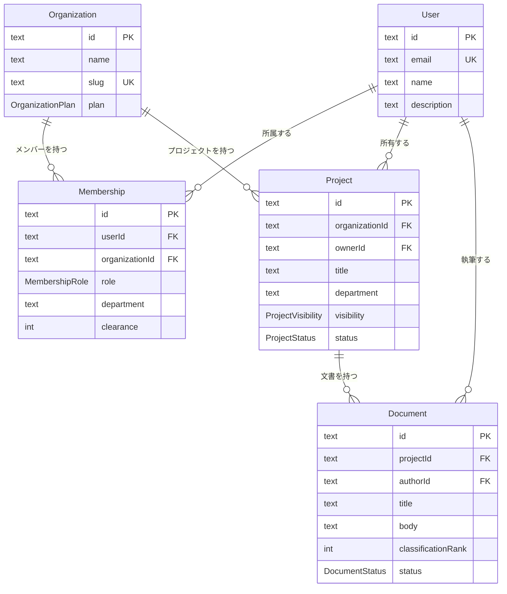

# データベース

PostgreSQL 17 上のテーブル定義です。正は `prisma/schema.prisma` で、適用済みの SQL は `prisma/migrations` にあります。接続先は `docker-compose.yml` の `scylla` データベースです。

主キーの `id` は Prisma が挿入時に作る `cuid` の文字列です。データベース側には既定値がありません。`Project.status`、`Document.status`、`Organization.plan` の既定値だけが PostgreSQL 側にあります。列はすべて `NOT NULL` です。

## ER 図

一人のユーザーは複数の組織に所属できます。同じユーザーと組織の組は `Membership` に1行だけです。プロジェクトは1つの組織に属し、所有者は1人のユーザーです。文書は1つのプロジェクトに属し、著者は1人のユーザーです。

## 列挙型

| 型 | 値 |
| --- | --- |
| `MembershipRole` | `owner`, `admin`, `member`, `guest` |
| `OrganizationPlan` | `starter`, `business`, `enterprise` |
| `ProjectVisibility` | `private`, `department`, `organization` |
| `ProjectStatus` | `draft`, `active`, `archived` |
| `DocumentStatus` | `draft`, `published` |

PostgreSQL ではそれぞれ `CREATE TYPE ... AS ENUM` です。

## User

人そのものです。認可に使うロール、部門、クリアランスはここには無く、`Membership` にあります。

| 列 | 型 | 制約 | 内容 |
| --- | --- | --- | --- |
| `id` | `TEXT` | 主キー | Prisma が生成する `cuid` |
| `email` | `TEXT` | 一意 | メールアドレス |
| `name` | `TEXT` | | 表示名 |
| `description` | `TEXT` | | 画面に出す、その人の説明 |

索引は主キーと `User_email_key` です。

## Organization

契約の単位です。プランは組織の列であり、ユーザーには持ちません。

| 列 | 型 | 制約 | 内容 |
| --- | --- | --- | --- |
| `id` | `TEXT` | 主キー | Prisma が生成する `cuid` |
| `name` | `TEXT` | | 表示名。seed では Acme と Nimbus |
| `slug` | `TEXT` | 一意 | URL 用の識別子 |
| `plan` | `OrganizationPlan` | 既定値 `starter` | 契約プラン。後から追加した列 |

索引は主キーと `Organization_slug_key` です。

## Membership

ユーザーと組織の所属です。同じ人でも組織が違えば行が分かれ、ロール、部門、クリアランスも行ごとに違います。

| 列 | 型 | 制約 | 内容 |
| --- | --- | --- | --- |
| `id` | `TEXT` | 主キー | Prisma が生成する `cuid` |
| `userId` | `TEXT` | 外部キー `User.id` | 所属する人 |
| `organizationId` | `TEXT` | 外部キー `Organization.id` | 所属先の組織 |
| `role` | `MembershipRole` | | その組織でのロール |
| `department` | `TEXT` | | その組織での部門。`engineering` などの文字列 |
| `clearance` | `INTEGER` | | その組織でのクリアランス。seed では 1、2、3 |

`Membership_userId_organizationId_key` が `(userId, organizationId)` の一意制約です。一人が同じ組織に2回所属することはできません。

削除はどちらも `ON DELETE CASCADE` です。ユーザーを消すとその所属行も消え、組織を消すとその組織の所属行も消えます。更新は `ON UPDATE CASCADE` です。

## Project

組織に属するプロジェクトです。部門と公開範囲は、所属側の部門とは別に、この行自身が持ちます。

| 列 | 型 | 制約 | 内容 |
| --- | --- | --- | --- |
| `id` | `TEXT` | 主キー | Prisma が生成する `cuid` |
| `organizationId` | `TEXT` | 外部キー `Organization.id` | 属する組織 |
| `ownerId` | `TEXT` | 外部キー `User.id` | 所有者 |
| `title` | `TEXT` | | タイトル |
| `department` | `TEXT` | | プロジェクトの部門 |
| `visibility` | `ProjectVisibility` | | 公開範囲 |
| `status` | `ProjectStatus` | 既定値 `active` | 下書き、進行中、アーカイブ |

`Project_organizationId_idx` が `organizationId` の索引です。

`organizationId` の削除は `CASCADE` です。組織を消すと、そのプロジェクトも消えます。`ownerId` の削除は `RESTRICT` です。プロジェクトを所有しているユーザーは消せません。

## Document

プロジェクトに属する文書です。本文と等級はここにあります。著者のメールは `User.email` にあり、このテーブルにはコピーしません。

| 列 | 型 | 制約 | 内容 |
| --- | --- | --- | --- |
| `id` | `TEXT` | 主キー | Prisma が生成する `cuid` |
| `projectId` | `TEXT` | 外部キー `Project.id` | 親プロジェクト |
| `authorId` | `TEXT` | 外部キー `User.id` | 著者 |
| `title` | `TEXT` | | タイトル |
| `body` | `TEXT` | | 本文 |
| `classificationRank` | `INTEGER` | | 等級。seed では 1 が公開、2 が社内、3 が機密 |
| `status` | `DocumentStatus` | 既定値 `draft` | 下書きか公開済み |

`Document_projectId_idx` が `projectId` の索引です。

`projectId` の削除は `CASCADE` です。プロジェクトを消すと文書も消えます。`authorId` の削除は `RESTRICT` です。文書を書いているユーザーは消せません。

## 削除が伝わる範囲

組織を削除すると、その `Membership`、`Project`、プロジェクト配下の `Document` が連鎖して消えます。ユーザーを削除すると `Membership` は消えますが、その人が `Project.ownerId` または `Document.authorId` に残っているあいだは削除できません。
